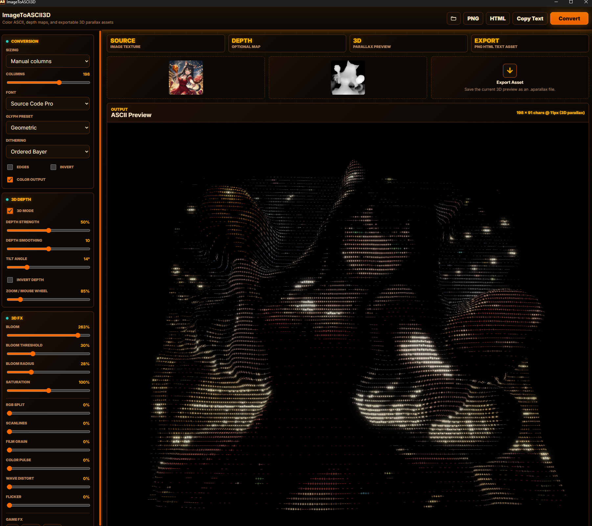
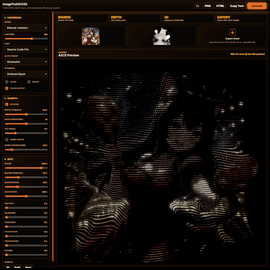

# ImageToASCII3D

> Turn images into color ASCII art, add depth-driven 3D parallax, and export the result for the web or your creative pipeline.

[](https://github.com/neko-legends/image-to-ASCII-3D)
[](https://tauri.app/)
[](LICENSE)





ImageToASCII3D is a Windows desktop tool for producing stylized ASCII art from ordinary images. It can work as a fast 2D converter or combine a source image with a depth map to create an interactive Three.js parallax scene. Once you convert an image, control changes update the result in real time.

## Highlights

- Color or monochrome ASCII with multiple glyph presets and fonts
- Fit, stretch, and manual column sizing
- Dithering, edge detection, inversion, and live control updates
- Optional depth-map-driven 3D parallax with mouse-wheel zoom
- Bloom, saturation, RGB split, scanlines, grain, pulse, wave, and flicker
- Game-style hit, death, and reset effects
- Drag-and-drop support for PNG, JPEG, GIF, WebP, AVIF, BMP, SVG, ICO, and related image types
- Export to PNG, standalone HTML, plain text, or reusable `.aparallax` assets
- Open `.aparallax` assets without needing the original source images

## Get The App

Windows users can choose either build:

| Build | Best for | Output |
| --- | --- | --- |
| NSIS installer | A normal installed app with Start Menu and uninstall support | `release/installer/image-to-ascii-3d-setup.exe` |
| Portable | Running directly without installation | `release/portable/image-to-ascii-3d.exe` |

The repository does not commit generated executables. Build them locally using the commands below, or download published binaries from the repository's releases when available.

Linux users get an AppImage from the releases page. Make it executable (`chmod +x`) and run it, or let [Neko Legends Control Center](https://github.com/neko-legends/neko-legends-control-center) install, update and launch it for you. Tested on Omarchy (Arch Linux + Hyprland, Wayland, NVIDIA).

## Quick Start

1. Open or drop a source image into the **Source** field.
2. Optionally add a grayscale depth map to the **Depth** field and enable **3D Mode**.
3. Select **Convert** once. Further setting changes update the preview automatically.
4. Export a PNG, HTML document, copied text, or `.aparallax` asset.

## Build From Source

Requirements: Windows, Node.js 18 or newer, npm, Rust, and the Tauri Windows prerequisites.

```powershell
git clone https://github.com/neko-legends/image-to-ASCII-3D.git
cd image-to-ASCII-3D
npm install
```

Run the native desktop app in development:

```powershell
npm run dev
```

Build the stable portable executable:

```powershell
npm run build:portable
```

Build the stable NSIS installer:

```powershell
npm run build:installer
```

Release builds bundle the frontend inside the executable. They do not launch a browser or require a localhost server.

## Optional Web Development

The same interface can run in a browser for frontend development and testing:

```powershell
npm run dev:web
```

- Development server: `http://127.0.0.1:1470/`
- Preview server: `http://127.0.0.1:1471/`

This mode is optional; the distributed application is the native Tauri app.

## For AI Coding Agents

If you are using Codex or another coding agent, give it the repository root and keep these project contracts intact:

- This is an npm workspace. Run `npm install`, `npm run build`, and `npm test` from the repository root.
- `npm run dev` launches Tauri. Use `npm run dev:web` only when browser mode is explicitly needed.
- Keep UI code in `apps/web`, conversion logic in `packages/core`, `.aparallax` logic in `packages/parallax-reader`, and native commands/configuration in `src-tauri`.
- Preserve the 2D workflow when no depth map is loaded and the optional 3D workflow when one is present.
- Preserve PNG, HTML, plain-text, `.aparallax` export, and `.aparallax` import behavior.
- Extend the core tests when changing glyph mapping, resizing, dithering, luminance, or frame output.
- Do not commit `node_modules`, compiled `dist` directories, `src-tauri/target`, `release`, or generated exports.
- Use `npm run build:portable` and `npm run build:installer` for consistently named Windows artifacts.

A useful starter prompt is:

```text
Work in this ImageToASCII3D repository. Preserve the Tauri desktop workflow,
run the relevant tests, build the requested Windows artifact, and report the
exact output path. Keep conversion logic covered by tests and do not commit
generated build artifacts.
```

## Project Layout

```text
apps/web                  Vite interface and desktop frontend
packages/core             Image-to-ASCII conversion engine
packages/parallax-reader  .aparallax encoder, decoder, and mesh loader
src-tauri                 Tauri desktop shell and Windows bundling
scripts                   Stable portable and installer build scripts
tests                     Conversion engine tests
docs/images               README and documentation media
```

## Contributing

Focused fixes and features are welcome. Before opening a pull request, run:

```powershell
npm test
npm run build
```

## License

[MIT](LICENSE) © ImageToASCII3D contributors
